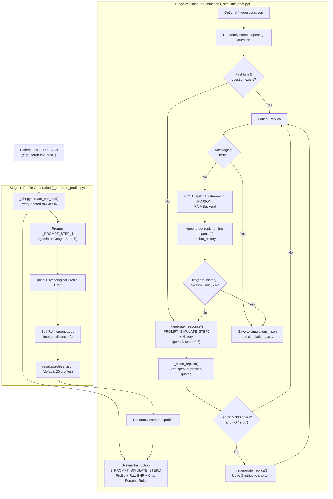

# Patient Replica Simulation Flow

This document describes the current end-to-end approach used in this directory to simulate patient chat behavior ("patient replicas") against the MAIA medical AI assistant, starting from an HL7 FHIR patient EHR JSON bundle.

## Overview

The pipeline is split into two offline/online stages backed by Vertex AI (Gemini via `google-genai`):

1. **Psychological Profile Generation (`_generate_profile.py`)**: Synthesizes a pool of diverse psychological profiles from a single patient's FHIR EHR JSON using an initial generation + iterative self-refinement loop.
2. **Interactive Chat Simulation (`_simulate_chat.py`)**: Samples a generated profile (and optionally an opening question), runs a multi-turn dialogue loop between a Gemini-powered patient simulator and the MAIA backend (`/api/chat`), enforces chat-style brevity via a length-based regeneration guardrail, and records transcripts to JSON and CSV.



---

## Codebase Components

| File | Responsibility |
| --- | --- |
| `_ehr.py` | Loads the patient EHR JSON file and serializes it as a pretty-printed UTF-8 string (`create_ehr_hint`). |
| `_prompts.py` | Defines the German-language prompts for psychological profile creation (`_PROMPT_STEP_1`), patient system persona (`_PROMPT_SIMULATE_STEP1`), and per-turn generation (`_PROMPT_SIMULATE_STEP2`). |
| `_generate_profile.py` | Generates and iteratively refines N psychological profiles from an EHR JSON and saves them to `results/profiles_<suffix>.json`. |
| `_simulate_chat.py` | Orchestrates login to MAIA, loads profiles/questions, runs multi-turn patient-vs-MAIA dialogues, enforces replica length limits, and writes JSON/CSV logs. |

---

## Input: Patient EHR JSON

The pipeline starts from a patient EHR file formatted as an HL7 FHIR `Bundle` (`type: "collection"`), such as the Sarah Levi BRCA1+ TNBC survivor example. It typically combines:

- **Demographics & coverage**: `Patient`, `Organization`, `Coverage`.
- **Clinical history**: `Condition`, `RiskAssessment`, `Procedure`, `MedicationStatement`, `ServiceRequest`.
- **Psychosocial & family context**: `Observation` notes (e.g., occupation, body dysmorphia, mistrust of centralized health databases) and `FamilyMemberHistory` (e.g., generational trauma, carrier guilt).

In `_ehr.py`, `create_ehr_hint(ehr_path)` reads this JSON and dumps the entire structure verbatim (`json.dumps(data, ensure_ascii=False, indent=2)`). No fields are stripped, summarized, or redacted before being injected into the LLM prompts.

---

## Stage 1: Psychological Profile Generation

Implemented in `_generate_profile.py`:

1. **Prompt Construction**: Inserts the full EHR JSON into `_PROMPT_STEP_1`, asking the model (in German) to produce a detailed psychological profile covering personality traits, fears, communication style, background, and specific information needs.
2. **Model & Grounding**: Calls Vertex AI (`gemini-3.8-flash`, API `v1`, `location="global"`) with Google Search grounding enabled (`tools=[{"google_search": {}}]`).
3. **Iterative Refinement**: Each profile undergoes `max_revisions = 2` sequential refinement passes in `generate_single_profile()`, where the model is prompted to reflect on and improve its previous draft.
   - *Note*: The refinement prompt passes only `current_profile` (not the original EHR JSON).
4. **Incremental Persistence**: Generates `num_profiles` profiles sequentially (default `20`) and overwrites `./results/profiles_<suffix>.json` after each profile (`{"profiles": [...]}`).

---

## Stage 2: Patient Replica Simulation

Implemented in `_simulate_chat.py`:

### 1. Setup & Asset Loading
- **Path Resolution (`_resolve_ehr_path`)**: Resolves the EHR path relative to CWD, script directory, or project root (including stripping leading `data/`).
- **Profile Loading (`load_profiles`)**: Searches explicit `--profiles_path` and several default candidate paths (`./results/profiles_<suffix>.json`, etc.). Fails if no profiles file exists.
- **Opening Questions (`load_questions`)**: Optionally loads a list of initial questions from `*_questions.json` or `questions_*.json` (with a regex fallback to tolerate trailing commas in JSON). If none is found, the first patient turn is generated dynamically by the LLM.
- **Backend Authentication (`login`)**: Authenticates once via `POST /api/login` using `httpx.AsyncClient` (120s timeout), persisting session cookies across all simulations in the batch.

### 2. Persona Conditioning & Prompting
Each simulation (`_generate`) assigns a random `user_id` (`uuid4`) and randomly samples one profile (`profile_id`) from the loaded pool.

For every LLM-generated patient turn (`_generate_response`):
- **Model Config**: Uses `gemini-3.8-flash` (configurable via `--model`), `temperature = 0.7`, and `max_output_tokens = _MAX_LENGTH` (default `1000`).
- **System Instruction (`_PROMPT_SIMULATE_STEP1`)**: Combines the sampled `{profile}` and the full `{ehr}` JSON with five explicit chat-behavior rules:
  1. **Very short chat-style replies**: 1–3 short sentences (at most one short paragraph); never essays or structured lists.
  2. **No repetition or summarization of the bot**: Never paraphrase, summarize, or echo the chatbot's statements or statistics.
  3. **Authentic human voice**: Natural everyday language and emotions consistent with the profile; never sound like an AI, medical report, or examiner.
  4. **Single focus**: React to the one point that matters most right now, or ask a direct follow-up question.
  5. **Termination signal**: Reply exclusively with the single word `'fertig'` when all questions are answered or the patient wants to end the chat.
- **Turn Prompt (`_PROMPT_SIMULATE_STEP2`)**: Passes the flattened conversation history from `_merge_history()` (`Patient: ...` / `Chatbot: ...` lines, or `"START A NEW CHAT"` on turn 1 when no seed question is provided), followed by a brief reminder of the core rules.

### 3. Post-Processing & Length Guardrail
Because LLMs tend to drift toward verbose or formatted outputs, every generated replica passes through a two-step post-processing pipeline:

1. **Artifact Cleaning (`_clean_replica`)**:
   - Strips leading `Patient:` speaker prefixes (including markdown bold/italic/heading wrappers like `**Patient:**`).
   - Strips stray leading colons and matching outer single/double quotes.
2. **Length Enforcement via Regeneration (`_is_replica_too_long` + `_regenerate_replica`)**:
   - Checks whether `len(replica) > threshold` (default `_REPLICA_THRESHOLD = 300` characters). Messages matching `'fertig'` are exempt.
   - If over the threshold, runs up to `max_retries = 3` regeneration calls using `_build_regeneration_prompt()` (localized for `de`, `en`, or `ru`), showing the model the history, its overly long draft, the exact character count, and the target character limit while preserving the original `system_instruction` and `temperature = 0.7`.
   - Each regenerated candidate is cleaned again; the loop exits as soon as a candidate falls within the threshold (otherwise the last non-empty candidate is kept).

### 4. MAIA Backend Exchange
On each non-terminal turn:
- Sends `POST /api/chat` with:
  ```json
  {
    "message": "<patient replica>",
    "history": [{"role": "user" | "assistant", "content": "..."}],
    "is_first_interaction": true | false,
    "language": "de"
  }
  ```
  (`history` is `null` on the first interaction.)
- Streams the response line-by-line as NDJSON (`response.aiter_lines()`), concatenating chunks where `type == "content"` and logging chunks where `type == "error"`.
- Appends the concatenated answer to `chat_history` as `{"role": "chat", "text": final_answer}`, or `{"role": "chat", "text": "[no response]"}` if the request failed or returned empty content.

### 5. Termination Conditions
A simulation loop ends when either:
- **Patient terminates naturally**: The normalized patient message equals `"fertig"`, starts with `"fertig "`, or ends with `" fertig"` / `"\nfertig"` (the `'fertig'` message is not sent to MAIA or appended to `chat_history`).
- **Turn limit reached**: `len(chat_history) >= turn_limit`, where `turn_limit` defaults to `_MAX_TURNS = 50` messages (25 patient + 25 chatbot turns) when `max_length >= 100`, or `max_length` otherwise.

### 6. Output Format
After each simulation completes, `_save_simulation_results()` persists results in `output_dir` (default `./results`):
- **`simulations_<suffix>.json`**: Accumulates all simulations under `{"simulations": [{"chat_history": [...], "user_id": "...", "profile_id": int}, ...]}`.
- **`simulations_<suffix>.csv`**: Appends one row per turn with columns `simulation_id,profile_id,speaker,message` (`speaker` is `"user"` or `"chat"`).

---

## Notable Design Characteristics & Current Limitations

- **Language Coupling**: `_PROMPT_STEP_1`, `_PROMPT_SIMULATE_STEP1`, `_PROMPT_SIMULATE_STEP2`, and the `'fertig'` stop token are hardcoded in German, whereas `_build_regeneration_prompt()` and the MAIA `/api/chat` payload accept `--language` (`de`, `en`, `ru`).
- **Context Size**: The entire raw FHIR Bundle JSON is injected verbatim into the system instruction on every turn and every regeneration retry.
- **Stateless Refinement**: In `_generate_profile.py`, the 2 refinement passes do not re-attach the original EHR, so refinements cannot cross-check facts against the source record.
- **Sequential Execution**: Both profile generation (`for i in range(num_profiles)`) and batch simulations (`for i in range(num_simulations)`) run sequentially rather than concurrently.
- **Guardrail Scope**: Post-generation validation currently checks only formatting artifacts and character length (`300` chars); there is no automated check for persona drift, hallucinated medical facts, or chatbot-paraphrasing beyond prompt instructions.
